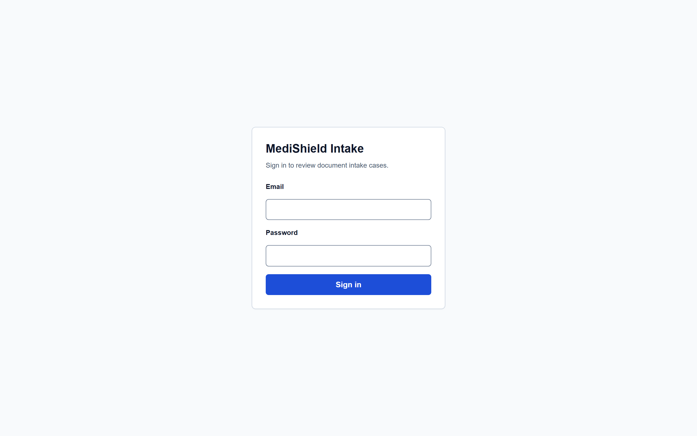
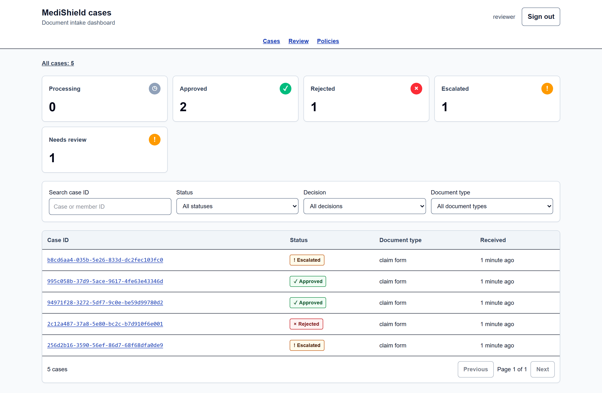

# MediShield Intake

MediShield is a multi-agent insurance-document intake system.

> Evaluation (real Groq models, synthetic data): holdout 0.861 decision correctness (93/108), run once; a later re-run after fixes reached 0.898 (not independent); dev 0.950 on a 40-document sample. See [reports/evaluation_summary.md](reports/evaluation_summary.md) and [docs/known-limitations.md](docs/known-limitations.md).

It ingests claim documents and policy PDFs, runs OCR/classification/KYC/claims/policy/fraud agents, persists audit evidence, and presents decisions in a Next.js case-management UI.

## Demo video

[Watch the demo video](docs/medishield-demo.mp4)

Walkthrough : dashboard and document upload, Processing.

## Screenshots





## Architecture

- **FastAPI** API: authentication, uploads, case/policy endpoints, signed document URLs
- **Celery + Redis**: asynchronous document pipeline and policy ingestion queues
- **LangGraph**: routed seven-stage agent workflow
- **PostgreSQL 16**: cases, users, evidence, audit events and policy metadata
- **MinIO**: immutable raw documents and policy PDFs
- **Qdrant**: dense/sparse policy retrieval
- **Docling**: policy PDF parsing and section-aware chunking
- **Tesseract**: first local OCR tier
- **Groq vision**: `qwen/qwen3.8-27b`
- **Groq text**: `openai/gpt-oss-120b`
- **Next.js**: case-management web UI

See [docs/architecture.md](docs/architecture.md) for the component diagram.

## Prerequisites

- Python 3.12+
- [uv](https://docs.astral.sh/uv/) package manager
- Node.js 20+
- Docker with Docker Compose
- Tesseract OCR 5+ (`tesseract` on `PATH`, or set `TESSERACT_CMD`)
- Windows: Docker Desktop, Node, uv, and Tesseract
- Linux: Docker with Compose, Node 20+, uv, and `tesseract-ocr`

## Environment variables

Copy `.env.example` to `.env`. The file contains placeholders only; it is not a source of credentials.

| Variable | Purpose |
|---|---|
| `POSTGRES_DB`, `POSTGRES_TEST_DB`, `POSTGRES_USER`, `POSTGRES_PASSWORD` | PostgreSQL databases and credentials |
| `DATABASE_URL`, `TEST_DATABASE_URL` | Application and isolated test databases |
| `REDIS_URL`, `REDIS_PASSWORD` | Celery broker/result backend and Redis pub/sub |
| `S3_ENDPOINT`, `S3_ACCESS_KEY`, `S3_SECRET_KEY`, `S3_BUCKET`, `S3_TEST_BUCKET` | MinIO/S3 storage |
| `MINIO_PUBLIC_URL` | Public or LAN URL for browser-visible document links |
| `QDRANT_URL`, `QDRANT_API_KEY` | Vector database |
| `LLM_PROVIDER` | `stub`, `groq`, `anthropic`, or `openai` |
| `LLM_VISION_MODEL`, `LLM_TEXT_MODEL` | Vision/text model IDs; Groq examples are `qwen/qwen3.8-27b` and `openai/gpt-oss-120b` |
| `LLM_FALLBACK_PROVIDER`, `LLM_FALLBACK_MODEL` | Optional text fallback provider/model |
| `GROQ_API_KEY`, `ANTHROPIC_API_KEY`, `OPENAI_API_KEY` | Optional provider credentials |
| `LLM_RECORD_FIXTURES`, `LLM_DEBUG_RAW` | Offline fixture recording and opt-in development raw diagnostics |
| `GROQ_RPM_LIMIT`, `GROQ_TPM_LIMIT`, `GROQ_QWEN_TPM_LIMIT`, `GROQ_TPD_LIMIT` | Groq rate and budget limits |
| `GROQ_QWEN_OTPM_LIMIT`, `GROQ_GPT_OSS_OTPM_LIMIT`, `GROQ_LIMITER_WAIT_MAX_S` | Groq output and limiter settings |
| `JWT_SECRET`, `JWT_TTL_MIN`, `SERVICE_TOKEN` | API authentication and upload-only automation token |
| `SEED_TEST_USER_PASSWORD` | Password for seeded development/test users |
| `TESSERACT_CMD`, `EMBEDDING_MODEL` | OCR executable and embedding model |
| `APP_ENV`, `UI_ORIGIN`, `API_URL` | Environment and browser/API origins |

## Windows setup: fewer than 10 commands

```powershell
Copy-Item .env.example .env
uv sync
docker compose --env-file .env -f infra/docker-compose.yml up -d --wait
uv run python -m scripts.init_local
uv run alembic upgrade head
uv run python scripts/seed.py
uv run python scripts/ingest_policies.py
npm --prefix apps/web ci
```

## Linux setup: fewer than 10 commands

```bash
cp .env.example .env
uv sync
docker compose --env-file .env -f infra/docker-compose.yml up -d --wait
uv run python -m scripts.init_local
uv run alembic upgrade head
uv run python scripts/seed.py
uv run python scripts/ingest_policies.py
npm --prefix apps/web ci
```

Fill placeholder secrets in `.env` before starting authenticated services. `LLM_PROVIDER=stub` needs no provider credentials.

## Run locally

API:

```bash
uv run uvicorn apps.api.main:app --host 127.0.0.1 --port 8000
```

Celery worker:

```bash
uv run celery -A apps.worker.celery_app.celery_app worker --loglevel=info --pool=solo
```

Web:

```bash
npm --prefix apps/web run dev
```

Open `http://localhost:3000`. Seeded test users are `reviewer@medishield.test`, `supervisor@medishield.test`, `auditor@medishield.test`, `admin@medishield.test` and `uploader@medishield.test`. Their password comes from `SEED_TEST_USER_PASSWORD` in `.env`; no password is stored in tracked source files.

For a production-mode demo (without the Next.js development indicator):

```bash
npm --prefix apps/web run build
npm --prefix apps/web run start
```

## Demo Data

Preview the local demo reset with `uv run python -m scripts.reset_demo_data`. Add `--yes` to apply it.
It removes only decisionless cases explicitly marked `DEMO_RESET` with `demo/reset/` object keys,
and creates five synthetic examples. Unmarked cases, including older uploads of unknown origin,
are not removed. Policies, users, and canonical dataset records are never changed.
Stop workers before applying the reset; it refuses remote or production databases.

## Evaluation

```bash
uv run python -m packages.eval.run --provider stub --split dev --stratified 20
uv run python -m packages.eval.run --provider groq --split dev --stratified 20
uv run python -m packages.eval.run --provider groq --split holdout --stratified 20
```

`--stratified 20` performs document-level sampling: scenario coverage, valid-clean coverage for each core document type, and `_dup`/original companion ordering. Groq evaluation reserves estimated tokens for the minute limiter but records `prompt_tokens + completion_tokens` actual usage in the UTC rolling 24-hour ledger. The 90% `GROQ_TPD_LIMIT` stop threshold is intended to prevent free-tier exhaustion. Successful responses are cached; rerunning resumes cache hits and only calls uncached live documents. Never use holdout data to tune prompts or selection.

## Tests and lint

```bash
uv run pytest
uv run ruff check .
uv run pytest packages/tests/test_decision.py --cov=packages.decision --cov-report=term-missing --cov-fail-under=100
npm --prefix apps/web run lint
(cd apps/web && npx tsc --noEmit)
npm --prefix apps/web run build
(cd apps/web && npm run test:e2e)
```

The database migration suite recreates the test database schema and must use `TEST_DATABASE_URL` for `medishield_test`, never the development database.

## End-to-end sample

Start infrastructure and processes, then use the seeded user password to log in:

```bash
TOKEN=$(curl -fsS -X POST http://127.0.0.1:8000/api/v1/auth/login -H 'Content-Type: application/json' -d '{"email":"reviewer@medishield.test","password":"'$SEED_TEST_USER_PASSWORD'"}' | python -c 'import json,sys; print(json.load(sys.stdin)["access_token"])' )
CASE=$(curl -fsS -X POST http://127.0.0.1:8000/api/v1/cases -H "Authorization: Bearer $TOKEN" -F 'file=@data/synthetic/dataset/claim_forms/claim_PT_19116.png' | python -c 'import json,sys; print(json.load(sys.stdin)["case_id"])')
curl -fsS -H "Authorization: Bearer $TOKEN" "http://127.0.0.1:8000/api/v1/cases/$CASE"
```

Expected: upload HTTP 202 with a `case_id` and `RECEIVED`/processing status; the case detail eventually shows a classification, OCR and routed agent results, plus a final `APPROVE`, `REJECT`, or `ESCALATE` decision according to the document scenario.

## Documentation

- [Architecture](docs/architecture.md)
- [Design decisions](docs/design-decisions.md)
- [Known limitations](docs/known-limitations.md)
- [Technical specification](docs/spec.md)
- [Architecture decisions](docs/adr.md)
- [Evaluation summary](reports/evaluation_summary.md)

## Repository layout

- `apps/api` — FastAPI application and endpoints
- `apps/worker` — Celery worker and task definitions
- `apps/web` — Next.js case-management UI
- `packages/agents` — classifier, OCR, KYC, claims, policy and fraud agents
- `packages/decision` — deterministic rule precedence and decision engine
- `packages/graph` — LangGraph state and pipeline routing
- `packages/rag` — Docling parsing, embeddings, chunking and Qdrant retrieval
- `packages/core` — configuration, database, storage and LLM adapters
- `data/synthetic` — synthetic documents, labels and truth data
- `infra` — Docker Compose and PostgreSQL migrations
- `scripts` — setup, seeding and policy ingestion utilities

## Full setup

Run infrastructure and application setup from the repository root:

```bash
uv sync
docker compose --env-file .env -f infra/docker-compose.yml up -d --wait
uv run python -m scripts.init_local
uv run alembic upgrade head
uv run python scripts/seed.py
uv run python scripts/ingest_policies.py
```

`uv run python scripts/seed.py` is the seed entry point and invokes `scripts.seed_from_dataset.seed_dataset` to seed dataset members and history. `scripts/seed_from_dataset.py` is a helper module, not a standalone command. Run `uv run python scripts/ingest_policies.py` after policy infrastructure is healthy.

## Groq configuration

Set `LLM_PROVIDER=groq`, `GROQ_API_KEY`, `LLM_VISION_MODEL=qwen/qwen3.8-27b` and `LLM_TEXT_MODEL=openai/gpt-oss-120b`. Groq settings include `GROQ_RPM_LIMIT`, `GROQ_TPM_LIMIT`, `GROQ_QWEN_TPM_LIMIT`, `GROQ_TPD_LIMIT`, `GROQ_QWEN_OTPM_LIMIT`, `GROQ_GPT_OSS_OTPM_LIMIT`, `GROQ_LIMITER_WAIT_MAX_S` and `LLM_LENGTH_RETRY_MAX_TOKENS`. Use stub/fixture providers for offline tests; never place live credentials in tracked files.

## Evaluation commands

```bash
uv run python -m packages.eval.run --provider stub --split dev --stratified 40
uv run python -m packages.eval.run --provider groq --split dev --stratified 40
uv run python -m packages.eval.run --provider groq --split holdout
```
