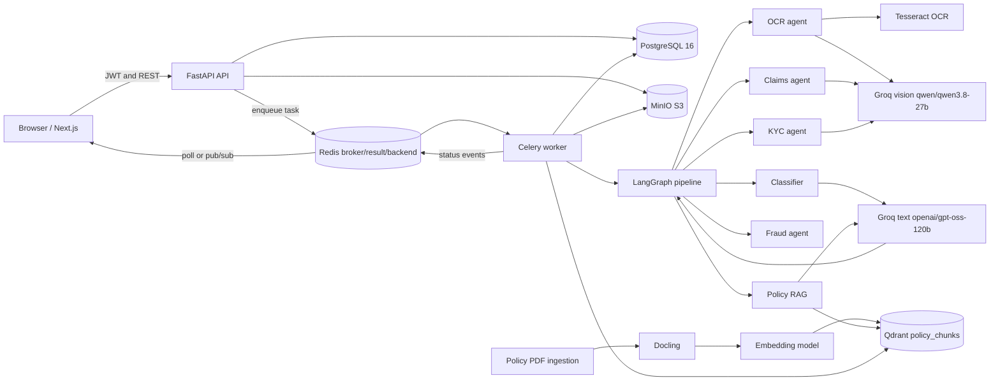

# MediShield Architecture

## Runtime view

## Document pipeline

1. FastAPI stores the original upload in MinIO and inserts a `Case` in PostgreSQL.
2. FastAPI publishes a Celery `run_pipeline` task through Redis.
3. Celery invokes the LangGraph graph; each agent is instrumented and persists agent runs/audit events.
4. PDF text layers are preferred; otherwise Tesseract is tried before the Qwen vision fallback.
5. OCR, KYC and Claims produce typed evidence. Policy retrieval uses Docling-derived Qdrant chunks, and fraud scoring consumes claim-history evidence.
6. The decision engine evaluates deterministic rules and writes the effective decision, confidence and justification.

## Policy ingestion

Policy PDFs are uploaded by API, stored in MinIO, parsed by Docling, section/chunk classified, embedded, and indexed in Qdrant with policy, version and effective-date metadata. Exclusion ranges are loaded into PostgreSQL for rule checks.

## Storage ownership

- PostgreSQL: transactional state and append-only audit history
- MinIO: unmodified source documents and policy PDFs
- Redis: broker, result backend and live status/pub-sub
- Qdrant: policy retrieval vectors and sparse BM25 payloads
- Local cache: successful evaluation LLM responses and UTC rolling actual-token ledger events

## Real model names

- Text: `openai/gpt-oss-120b`
- Vision: `qwen/qwen3.8-27b`
- Embedding: configured by `EMBEDDING_MODEL`, default `BAAI/bge-small-en-v1.5`
